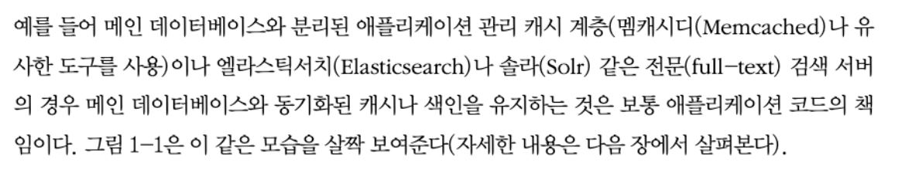

# 1장. 신뢰할 수 있고 확장 가능하며 유지보수하기 쉬운 애플리케이션

많은 앱은 다음을 필요로 한다.

- 구동 애비나 다른 앱에서 나중에 다시 데이터를 찾을 수 있게 데이터를 저장(데이터베이스)
- 읽기 속도 향상을 위해 값비싼 수행 결과를 기억(캐시)
- 사용자가 키워드로 데이터를 검색하거나 다양한 방법으로 필터링할 수 있게 제공(검색 색인)
- 비동기 처리를 위해 다른 프로세스로 메시지 보내기(스트림 처리)
- 주기적으로 대량의 누적된 데이터를 분석(일괄 처리)

앱마다 요구사항이 다르기 때문에 데이터베이스 시스템 또한 다양한 특성을 가지고 있다. 어떤 도구와 어떤 접근 방식이 가장 적합한지 생각해야함.

추가학습)

> **데이터스토어(datastore)**  
> 데이터를 저장하고 꺼내 쓰는 시스템을 모두 아우르는 말입니다. (데이터베이스, 캐시, 파일 저장소)  
>
> **레디스(Redis)**  
> 서버에서 돌아가는 인메모리 key-value 저장소입니다. 서버 여러 대가 함께 쓰는 거대한 `HashMap`이나 `LruCache`라고 생각하면 됩니다. 데이터를 메모리에 두기 때문에 매우 빠르고, 그래서 주로 캐시로 씁니다. 리스트와 pub/sub 기능도 있어서 메시지 큐로 쓰기도 합니다.  
>
> **메시지 큐(message queue)**  
> 보내는 쪽(producer)이 메시지를 넣어 두면, 받는 쪽(consumer)이 나중에 자기 속도에 맞춰 꺼내 처리하는 구조입니다. 안드로이드의 `Handler`와 `Looper`가 쓰는 `MessageQueue`와 같은 개념입니다. 다른 스레드에서 `post()`로 넣은 작업을 메인 스레드가 차례대로 꺼내 처리하는 것처럼, 서버끼리 작업을 비동기로 주고받을 때 씁니다.  
>
> **지속성(durability)**  
> "저장했다"는 응답을 받은 데이터는 프로세스가 죽거나 전원이 꺼져도 사라지지 않는다는 보장입니다. ViewModel의 변수는 프로세스가 죽으면 사라지지만, Room에 커밋된 데이터는 앱을 다시 켜도 남아 있습니다. 이 차이가 지속성의 유무입니다. SharedPreferences의 `commit()`이 디스크에 기록을 끝낸 뒤에 반환하고 `apply()`는 비동기로 기록하는 것도 같은 문제를 다룹니다.  
>
> **아파치 카프카(Apache Kafka)**  
> 메시지 큐의 일종이지만, 메시지를 꺼내 처리해도 지우지 않고 디스크에 로그로 계속 쌓아 둡니다. 소비자마다 "어디까지 읽었는지"(offset)를 따로 기억하기 때문에, 여러 소비자가 같은 메시지를 각자 읽을 수 있고 과거 메시지를 다시 읽을 수도 있습니다. 안드로이드로 비유하면, `replay`가 설정된 `SharedFlow`를 디스크에 영구 저장해 둔 것과 비슷합니다.

추가학습)

> 데이터를 데이터베이스에만 저장하는 것이 아니라, 캐시(Memcached)와 검색 색인(Elasticsearch)에도 사본을 둔다고 가정해 보겠습니다. 이때 데이터베이스는 자기 데이터가 바뀌어도 캐시나 색인에 그 사실을 알려 주지 않습니다. 세 시스템은 서로의 존재를 모르는 별개의 프로그램이기 때문입니다.
>
> 그래서 "DB가 바뀌면 캐시와 색인도 같이 바꾼다"는 일을 개발자가 직접 코드로 작성해야 합니다. 책에서 "애플리케이션 코드의 책임"이라고 한 말은 이 뜻입니다.

---

**신뢰성(Reliability)**

하드웨어나 소프트웨어 결함, 심지어 인적 오류(human error) 같은 **역경**에 직면하더라도 시스템은 지속적으로 **올바르게** 동작(원하는 성능 수준에서 정확한 기능을 수행)해야 한다.

**확장성(Scalability)**

시스템의 데이터 양, 트래픽 양, 복잡도가 **증가**하면서 이를 처리할 수 있는 적절한 방법이 있어야 한다. 

**유지보수성(Maintainability)**

시간이 지남에 따라 여러 다양한 사람들이 시스템 상에서 작업(현재 작업을 유지보수하고 새로운 사용 사례를 시스템에 적용하는 엔지니어링과 운영)할 것이기 때문에 모든 사용자가 시스템 상에서 **생산적으로** 작업할 수 있게 해야 한다.

### 신뢰성

잘못될 수 있는 일을 결함이라고 부른다. 결함을 예측하고 대처할 수 있는 시스템을 내결함성 또는 탄력성을 지녔다고 말한다. 결함은 장애와 동일하지 않다. 일반적으로 결함은 사양에서 벗어난 시스템의 한 구성 요소로 정의되지만, 장애는 사용자에게 필요한 서비스를 제공하지 못하고 시스템 전체가 멈춘 경우다.

> 결함(fault)은 **시스템의 한 부분**이 제대로 동작하지 않는 상태입니다. 그 결함 때문에 사용자가 서비스를 받지 못하게 되면 그때 비로소 장애(failure)가 됩니다. 책에서 결함을 세 종류로 나누므로, 그 순서대로 예를 들겠습니다.
>
> ## **하드웨어 결함**
>
>
> | **결함**                 | **장애로 번지지 않는 경우**                   | **장애로 번지는 경우**       |
> | :---------------------- | :----------------------------------- | :-------------------- |
> | 서버 10대 중 1대의 디스크가 고장 남 | 나머지 9대가 요청을 나눠 받아서 사용자는 아무것도 느끼지 못함 | 서버가 1대뿐이라 서비스 전체가 멈춤 |
> | 데이터센터 하나의 전원이 나감       | 다른 리전으로 트래픽이 넘어감                    | 모든 서버가 그 데이터센터에 있었음  |
> | 메모리 비트 하나가 뒤집힘         | ECC 메모리가 자동으로 바로잡음                  | 잘못된 값이 DB에 그대로 저장됨   |
>
>
> ## **소프트웨어 결함**
>
> - 특정 입력을 받으면 프로세스가 죽는 버그가 있습니다. 2012년 6월 30일에 윤초가 들어가면서 리눅스 커널 버그 때문에 많은 서버가 동시에 멈춘 사례가 유명합니다.
> - 프로세스 하나가 CPU나 메모리를 독점해서 같은 서버의 다른 프로세스가 느려집니다.
> - 시스템이 의존하는 외부 서비스가 느려지거나 이상한 응답을 돌려줍니다.
>
> 소프트웨어 결함은 여러 서버에 같은 코드가 깔려 있기 때문에 **동시에** 터지는 경향이 있습니다. 그래서 서버를 여러 대 두는 방법만으로는 막기 어렵습니다.
>
> ## **인적 오류**
>
> - 운영자가 설정 파일에 잘못된 값을 넣어 배포합니다.
> - 개발자가 실수로 운영 DB에 테스트용 쿼리를 실행합니다.
>
> 책에서는 인적 오류가 대규모 서비스에서 장애를 일으키는 가장 큰 원인이라고 설명합니다.
>
> ## **안드로이드로 비유하면**
>
> - **결함이지만 장애가 아닌 경우**: 이미지 로딩 서버가 응답하지 않아서 Coil이 placeholder 이미지를 보여 줍니다. 구성 요소 하나는 사양에서 벗어났지만, 사용자는 여전히 앱을 쓸 수 있습니다.
> - **결함이 장애로 번진 경우**: 같은 상황에서 예외를 잡지 않아 앱이 크래시합니다. 사용자는 앱을 아예 쓸 수 없게 됩니다.
>
> 책이 말하는 내결함성(fault-tolerant) 설계는 첫 번째 경우처럼 만드는 것입니다. 결함을 0으로 만들 수는 없으므로, 결함이 일어나도 장애로 번지지 않게 막는 장치를 두는 것이 목표입니다.

반직관적이지만 이러한 내결함성 시스템에서 경고 없이 개별 프로세스를 무작위로 죽이는 것과 같이 고의적으로 결함을 일으켜 결함률을 증가시키는 방법은 납득할만 하다. **고의적으로 결함을 유도함으로써 내결함성 시스템을 지속적으로 훈련하고 테스트해서 결함이 자연적으로 발생했을 때 올바르게 처리할 수 있다는 자신감을 높인다. 넷플릭스의 카오스 몽키가 이런 접근 방식의 한 예다.**

> 카오스 몽키(Chaos Monkey)는 넷플릭스가 2011년에 만든 도구입니다. **운영 중인 실제 서버를 무작위로 골라 강제로 꺼 버립니다.**

### 인적 오류

사람이 미덥지 않음에도 시스템을 어떻게 신뢰성 있게 만들까?

- 오류의 가능성을 최소화하는 방향으로 시스템을 설계하라. 예를 들어 잘 설계된 추상화, API, 관리 인터페이스를 사용하면 "옳은 일"은 쉽게 하고, "잘못된 일"은 막을 수 있다. 하지만 인터페이스가 지나치게 제한적이면 사람들은 좋은 점을 잊은 채 제한된 인터페이스를 피해 작업한다. 따라서 이런 시스템 설계는 올바르게 작동하게끔 균형을 맞추기가 어렵다.
- 사람이 가장 많이 실수하는 장소(부분)에서 사람의 실수로 장애가 발생할 수 있는 부분을 분리하라. 특히 실제 데이터를 사용해 안전하게 살펴보고 실험할 수 있지만 실제 사용자에게는 영향이 없는 비 프로덕션 **샌드박스(sandbox)**를 제공하라.
- 단위 테스트부터 전체 시스템 통합 테스트와 수동 테스트까지 모든 수준에서 철저하게 테스트하라[3]. 자동 테스트는 널리 사용되며 잘 알려져 있다. 특히 정상적인 동작에서는 거의 발생하지 않는 코너 케이스(corner case)를 다루는 데 유용하다.
- 장애 발생의 영향을 최소화하기 위해 인적 오류를 빠르고 쉽게 복구할 수 있게 하라. 예를 들어 설정 변경 내역을 빠르게 롤백(roll back)하고 새로운 코드를 서서히 롤아웃(roll out)하게 만들고(예상치 못한 버그가 일부 사용자에게만 영향이 미치게 함) 이전 계산이 잘못된 경우를 대비해 데이터 재계산 도구를 제공하라.
- 성능 지표와 오류율 같은 상세하고 명확한 모니터링 대책을 마련하라. 모니터링을 다른 엔지니어링 분야에서는 **원격 측정(telemetry)**이라고 부른다(일단 로켓이 발사되면 원격 측정은 일어나는 일을 추적하고 장애 해석을 위해 필수적이다[14]). 모니터링은 조기에 경고 신호를 보내줄 수 있고 특정 가정이나 제한을 벗어나는지 확인할 수 있게 한다. 문제가 발생했을 때 지표(metrics)는 문제를 분석하는 데 매우 중요하다.
- 조작 교육과 실습을 시행하라. 까다롭지만 매우 중요한 측면이다. 하지만 책의 범위를 벗어나므로 여기서 다루지는 않는다.

꼬리 지연 시간(tail latency)으로 알려진 상위 백분위 응답 시간은 서비스의 사용자 경험에 직접 영향을 주기 때문에 중요하다. 예를 들어 아마존은 내부 서비스의 응답 시간 요구사항을 99.9분위로 기술한다. 99.9분위는 요청 1000개 중 1개만 영향이 있음에도 말이다. 보통 응답 시간이 가장 느린 요청을 경험한 고객들은 많은 구매를 해서 고객 중에서 계정에 가장 많은 데이터를 갖고 있어서다. (즉, 이 고객들은 가장 소중한 고객이다.) 아마존은 응답 시간이 100밀리초 증가하면 판매량이 1% 줄어들고 1초가 느려지면 고객의 만족도 지표는 16% 줄어드는 현상을 관찰했다. 반면 99.99분위를 최적화하는 작업에는 비용이 너무 많이 들어서 충분히 이익을 가져다주지 못한다고 여겨진다.

### 유지보수성

소프트웨어 시스템 설계 원칙 세 가지

- 운용성: 운영팀이 시스템을 원활하게 운영할 수 있게 만들어라
- 단순성: 시스템에서 복잡도를 최대한 제거해 새로운 엔지니어가 시스템을 이해하기 쉽게 만들어라. (사용자 인터페이스의 단순성과는 다르다는 점에 유의하라)
- 발전성: 엔지니어가 이후에 시스템을 쉽게 변경할 수 있게 하라. 그래야 요구사항 변경 같은 예기치 않은 사용 사례를 적용하기가 쉽다. 이 속성은 유연성, 수정 가능성, 적응성으로 알려져 있다.

### 단순성: 복잡도 관리

좋은 추상화는 깔끔하고 직관적인 외관 아래로 많은 세부 구현을 숨길 수 있다. 또한 좋은 추상화는 다른 다양한 앱에서도 사용 가능하다. 이러한 재사용은 비슷한 기능을 여러 번 재구현하는 것보다 더 효율적일 뿐만 아니라 고품질 소프트웨어로 이어진다.

